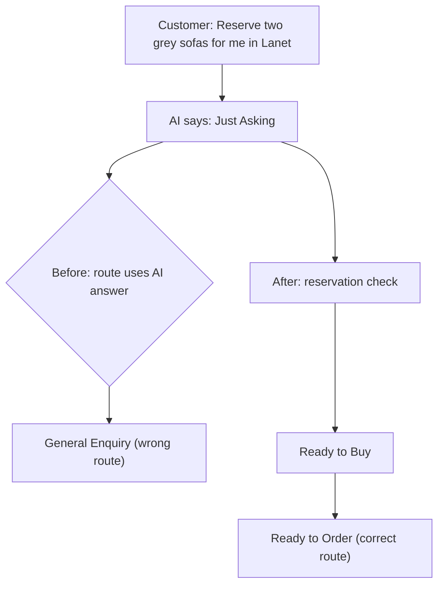
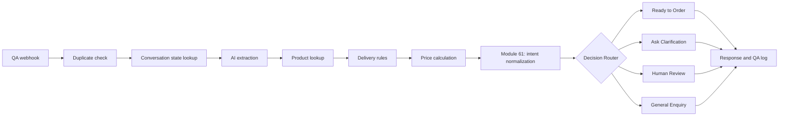

# AutomationGuard - Make.com Workflow Audit

I tested my furniture enquiry automation to see whether it made the **right decision**, not just whether Make.com reported a successful run.

## The problem

I sent the same message with fresh conversation records:

> Reserve two grey sofas for me in Lanet.

In one run, the AI understood it as an order. In another, it treated the customer as **Just Asking** and sent the request to **General Enquiry**.

## What I fixed

I worked in a separate QA copy, without changing the original automation.

- Added a rule to recognize selected clear reservation requests before routing.
- Updated the order and general-enquiry routes to use that result.
- Replaced the unhelpful “Payment method: unknown” reply with a question about how the customer wants to pay.

### Before and after

## Workflow overview

Only **Ready to Order** and **General Enquiry** use the normalized intent. Other filters may still use the AI's original intent. Conversation state is updated only where the workflow is configured to do so.

## What the retest showed

In the final run, the AI **again said Just Asking**, but the new rule changed the routing decision to **Ready to Buy**. The workflow selected **Ready to Order**, calculated **KSh 90,800**, asked whether the customer preferred **M-Pesa or cash on delivery**, and finished without errors.

I recorded **7 executions across 4 different test cases**. I also prepared a 30-case test framework, but have not run all 30. This proves the correction for the tested message, **not** the overall accuracy of the automation.

## Tools

Make.com · Make AI Toolkit · Google Sheets · Data Store · Webhooks · JSON

## Still to check

- Other ways customers might ask to reserve or cancel.
- Three other filters that still use the AI's original intent.
- Whether the saved conversation state and logged intent stay consistent with the routing decision.
- Multi-message conversations.

More detail: [Audit notes](docs/audit-findings.md) · [Test results](docs/test-results.md)

This QA work builds on my [Furniture Enquiry Automation](https://github.com/moodlighthaven-gif/whatsapp-furniture-enquiry-automation).

*Personal demonstration using synthetic customer enquiries, not paid client work. No real orders or payments were processed.*
